# Mohamed Tarek — DevOps Engineer

**I build and run the infrastructure behind multi-tenant SaaS products, from the DNS record to the database.**

---

## About this site

This is the source of my personal portfolio, a dark-themed, responsive, single-page site hosted on **GitHub Pages** at **[motarekdevops.github.io](https://motarekdevops.github.io)**.

It's built around one idea: the first screen should answer *who I am and what I do*, and everything else is one scroll or one click away.

**Sections**

| Section | What's inside |
|---|---|
| **Projects** | Production systems I designed, migrated or rescued, plus open-source tools, each with an architecture flow |
| **Skills** | Cloud and DevOps, frontend, business skills and the UX principles behind the page |
| **Credentials** | Certifications earned, courses completed and what's planned next |
| **Contact** | Email, LinkedIn and GitHub |

---

## Featured projects

### 🏗️ NEO Platform: multi-tenant SaaS hosting engine
Terraform-driven hosting with three plans (Core, Scale, Titan) and an AWS add-on marketplace. Isolated environment per client, one-click deployments, CI/CD over OIDC with automated rollback, and a 60-day trial tracked through Laravel API endpoints.
`Terraform` `AWS` `GitHub Actions` `Laravel API` `Docker`

### 📡 [ServerPlus](https://github.com/motarekdevops/ServerPlus): agentless server monitoring
Free, open-source dashboard that monitors and manages Linux servers over SSH. Nothing installed on the servers you watch, no cloud API, no data leaving your machine. Telegram alerts, SSL expiry monitoring with one-click Certbot renewal, 19 automated tests and GitHub Actions CI.
`Laravel 12` `Filament` `SQLite` `phpseclib` `Docker Compose`

### 📦 MasterOps: a package manager for DevOps projects
A CLI that sets up a project's infrastructure (Docker, Kubernetes, Nginx, CI/CD, security) in one go, in the spirit of `composer create-project`. Installed with `apt` from a private registry; every push to `main` builds and publishes the `.deb` automatically.
`Terraform` `Ansible` `Buildkite` `APT` `systemd`

### ☁️ Full AWS account migration
Moved every production workload from a legacy AWS account to a new one under a hard deadline across `us-east-1` and `us-east-2`: RDS from snapshots, WorkMail with no mail loss, rebuilt deploy pipelines and a Lambda backing WorkMail up to S3.

### 💬 WhatsApp Business API and NexusWA bridge
Full Meta WhatsApp Business integration for a Laravel app, with signature-validated webhooks and a dashboard that bridges conversations into Chatwoot.

### 🌐 Zero-downtime DNS migration and monitor
Cloudflare to Route 53 with pre-lowered TTLs, plus a Bash monitor polling eight global resolvers every 60 seconds and alerting on Telegram when propagation completed.

### 🎙️ Walkie Talkie
Push-to-talk server in Go (`gorilla/websocket`) with an embedded web client, served from a single binary.

> The site also covers Tijora (multi-tenant SaaS on k3s), Nexus ERP, queue-worker and CI/CD fixes, SES/WorkMail email setup, production EC2 recovery, Chatwoot on AWS and an S3/CloudFront bilingual file browser.

---

## Stack I work in

---

## Design principles

The same UX rules I apply to every interface, including this page:

- **Lead with the main job.** The first screen answers who I am and what I do.
- **Reveal detail on demand.** Summaries first, depth one click away.
- **Name actions plainly.** Buttons say what happens next.
- **Design for both languages.** Arabic and English with RTL from the start.
- **Accessible by default.** Visible focus, readable contrast, reduced motion respected.
- **One system, many screens.** Shared color, type and spacing tokens keep it consistent.

---

## Contact

Have infrastructure that needs an owner?

- 📧 [mohamedbentarek111@gmail.com](mailto:mohamedbentarek111@gmail.com)
- 💼 [LinkedIn](https://www.linkedin.com/in/mohamed-tarek-devops/)
- 🐙 [GitHub](https://github.com/motarekdevops)

© 2026 Mohamed Tarek · Cairo, Egypt

